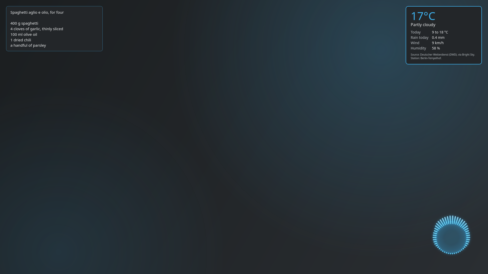
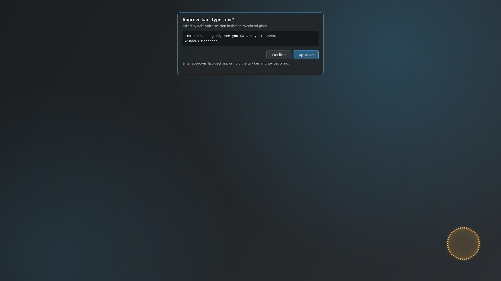
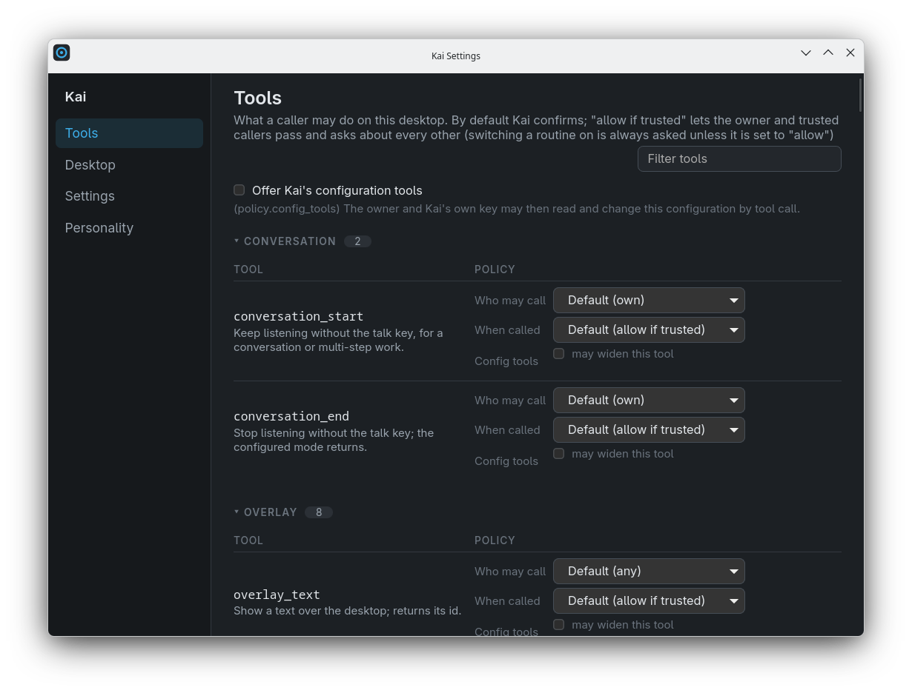
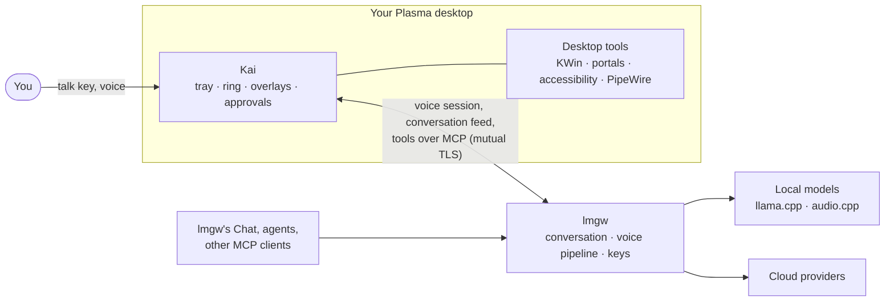

<p align="center">
  <picture>
    <source media="(prefers-color-scheme: dark)" srcset="docs/images/logo-dark.svg">
    
  </picture>
</p>

<p align="center">
  A voice assistant for the KDE Plasma desktop, running on your own models through lmgw.
</p>

<p align="center">
  <a href="https://github.com/lmgw-dev/kai/releases/latest"></a>
  <a href="https://github.com/lmgw-dev/kai/actions/workflows/ci.yml"></a>
  <a href="LICENSE.md"></a>
  
  
</p>

Kai lives in the Plasma tray. Press a shortcut in any app and talk, and Kai answers out loud while
a ring in the corner of the screen shows whether it is listening, thinking or speaking. Everything
you say goes into one ongoing conversation that you can also read and continue in a browser. The
model can use your desktop through tools: arrange windows, look at the screen, read text, open
files, type for you. You decide which tools run on their own and which ask first.

Kai runs no models itself. Speech recognition, the chat model and the voice all come from
[lmgw](https://github.com/lmgw-dev/lmgw), a self-hosted gateway that runs models on your own GPU
and can route to cloud providers too. Kai talks to whatever lmgw serves, and your conversation
stays in a gateway you run. The Android client is
[Kai mobile](https://github.com/lmgw-dev/kai-mobile).

<p align="center">
  <a href="docs/images/desktop.png"></a>
</p>

<table>
  <tr>
    <td align="center" width="50%">
      <a href="docs/images/approval.png"></a><br>
      <sub><b>Approval card</b> · Kai asks before it types; answer with Enter, Esc or your voice</sub>
    </td>
    <td align="center" width="50%">
      <a href="docs/images/settings.png"></a><br>
      <sub><b>Settings</b> · who may call each tool, and whether it asks first</sub>
    </td>
  </tr>
</table>

<sub>Stand-in content on a 1080p screen at 125 % scaling. `just readme-shots` makes these images
again.</sub>

## What it does

**Talk**
- **A talk key that works everywhere.** Tap it to start or stop listening, or hold it while you
  speak (push-to-talk). Kai records from the moment you press, so nothing is lost while a model
  loads. Talk over Kai to interrupt it.
- **One ongoing conversation.** Everything goes into a conversation in lmgw's Chat, in a folder
  called "Kai". Read it later, or carry on typing in the dashboard. After a quiet spell lmgw starts
  a fresh one, and the tray's **New conversation** does that at once.
- **Conversation mode.** For a longer exchange the model can keep listening without the key, until
  you end it or five minutes pass in silence.
- **Personalities.** The tray switches between lmgw's personality profiles, and the settings window
  edits them.

**See what's happening**
- **The tray icon** shows idle, listening, thinking, speaking or muted, with a badge while lmgw's
  GPU is on hold.
- **The ring** sits over the desktop while Kai is active and moves with the voice. It is the same
  ring as in lmgw's Chat.
- **Overlays.** The model can put small views over the desktop: text, a sandboxed HTML card, an
  image, an emote, a weather card. Kai also hosts [MCP Apps](https://modelcontextprotocol.io/), so
  a tool's own interactive view can show up there.

**Use the desktop**
- **Windows:** list, focus, tile, move between screens and desktops, maximise, close.
- **Seeing and reading:** a screenshot of a window or a screen for a vision model, a window's text
  through accessibility, the selection, the clipboard, file search, recent files.
- **Acting:** open files and links, start apps, run commands, media keys, volume, notifications, do
  not disturb, Night Light, brightness, lock and suspend.
- **Input:** press a button by its name, type text, press keys.
- **Helpers:** `look` and `find` hand a question to a second model that works with these tools and
  comes back with a short answer.
- **Jobs that outlive the turn.** A long command or routine runs in the background, and Kai tells
  you the result at the next quiet moment, or in a notification.
- **Routines.** A folder with a `routine.toml` becomes a tool of its own: a script, a fixed list of
  tool calls, or a goal for a helper model. You can also run it from the tray or a shortcut. A
  routine the model writes stays off until you switch it on.

**Stay in control**
- **A policy for every tool.** Each tool can run, ask first, be refused, or not be offered at all,
  and each says who may call it. See [Privacy and permissions](#privacy-and-permissions).
- **Approvals on the desktop.** A call that waits for your approval shows as a card. Enter
  approves, Esc declines, or you hold the talk key and say yes or no.
- **A settings window** for the tool policies, the desktop backends, every setting in the
  configuration file, and lmgw's personality profiles.

## Requirements

- **KDE Plasma 6 on Wayland**, with PipeWire. Kai is packaged as an x86_64 RPM, built on current
  Fedora.
- **lmgw 0.5.0 or later, with device pairing over TLS** (its device listener), on this machine or reachable over
  the network, with
  - a chat model (one with vision for the tools that look at the screen), and
  - speech-to-text and text-to-speech models set up for voice: **Settings → Chat → Voice** in lmgw,
    or **Settings → Realtime**, which the Chat falls back to.
- **KWallet** (or another Secret Service) to keep Kai's key.

## Install

Download the RPM from the [latest release](https://github.com/lmgw-dev/kai/releases/latest) and
install it:

```sh
sudo dnf install ./kai-*.x86_64.rpm
```

This installs `/usr/bin/kai`, the application menu entry (which also opens `lmgw-pair:` links) and
the icons. Nothing starts on its own yet: Kai offers **Start with Plasma** once it is paired.

Updates come from this repository's releases. Kai checks shortly after it starts and then every
six hours, and offers a new version in a notification (**Install**, **Later**, then **Restart**). Installing
asks for your password through `pkexec`, and Kai installs only an RPM whose checksum matches
the release's. The tray's **Check for Updates…** looks right away.

## Connect it to lmgw

Kai and lmgw talk over an encrypted, mutually authenticated link: Kai makes a key of its own when
you pair it, and lmgw gives it a certificate for that key.

1. Start **Kai** from the application menu. It shows up in the tray as "not paired".
2. In lmgw's dashboard, open **Usage → Keys & budgets** and choose **Pair a device…**. Give it a
   name, pick what it may use, and for the desktop tools a label under **hosts tools as**. Models
   then see the tools as `<label>__<tool>`, for example `kai__window_list`. For Kai on the same
   machine as lmgw, the device is on **this computer**.
3. lmgw shows a pairing link. Click it, or paste it into the dialog from Kai's tray menu (**Pair
   with lmgw…**). Kai shows what it is about to pair with and asks you to confirm, then makes its
   key, enrols it with lmgw, keeps the key in KWallet and switches **Start with Plasma** on.
4. Kai shows a code, and lmgw's Devices card shows one for the new device. When they match, click
   **Confirm** there; Kai connects at its next try (within 30 s, `retry_max_s` under `[lmgw]`).
5. On its first connection Kai creates the Chat folder **Kai**. In lmgw's Chat, open that folder's
   **Folder settings**, choose its **Model**, switch on **Ongoing conversation** (with the idle time
   after which a new conversation starts) and set **Retention**. Until the folder is ready, Kai
   lists the missing steps in a notification and in the tray tooltip.

The key never leaves your desktop, and the pairing belongs to Kai alone. It has a name, you can
revoke it on the same lmgw page at any time, and it never reaches lmgw's admin side. Its certificate
lasts a year by default; Kai says when it is due, and you pair it again.

**Open in lmgw** opens lmgw's dashboard at the address lmgw itself gives Kai. When Kai runs on
another machine and lmgw's dashboard listens on its own machine only, Kai says so: open the
dashboard there.

## Use it

1. **Bind the talk key.** The first time Kai starts, Plasma asks which keys to use. Kai suggests
   none, so pick your own; **System Settings → Shortcuts → Kai** changes them later. Besides
   *Talk to Kai* there are *new conversation*, *mute* and *hide every overlay*.
2. **Talk.** Tap the key and speak, and Kai hears when you're done (automatic mode). Or hold the
   key while you speak and let go to send (push-to-talk). A press while Kai speaks stops the reply.
3. **Pick the echo mode** in the tray's **Echo mode** menu. The default, *Input device cancels
   echo*, expects a microphone that does that itself, such as a speakerphone or a mic array. With
   an ordinary microphone and speakers choose *Kai cancels echo* (PipeWire's echo canceller), with
   a headset *Headphones*. *Half duplex* ignores the microphone while Kai speaks.
4. **Read it back.** The tray's **Open in lmgw** opens the conversation in lmgw's Chat.

The tray menu also holds the listening mode, mute, the microphone and speaker, the overlays on
screen, background jobs, routines, the personality, and **Settings…**.

For scripts and routines, Kai has a small command line:

```sh
kai tool                       # list the running Kai's tools
kai tool notify --help         # one tool's parameters
kai tool window_list           # call it, as the caller "cli", under your policy
echo "Two lines on PipeWire" | kai model <alias>   # ask one of lmgw's models through Kai's key
```

## Configuration

Settings live in `~/.config/kai/config.toml` (`$XDG_CONFIG_HOME/kai/config.toml`). Every key is
optional, and an unknown key is an error rather than silently ignored. The easiest way to change
them is the tray's **Settings…**: it lists every key with its default, says when a change needs a
restart, and keeps your comments in the file. A few worth knowing:

```toml
[voice]
mode = "automatic"            # or "push_to_talk"
on_at_start = false           # listening stays off at login until you press the talk key
conversation_timeout_s = 300  # conversation mode ends after this long without speech

[audio]
echo_mode = "device"         # device | app | headphones | half_duplex

[ring]
anchor = "bottom-right"       # where the ring sits (size = 240 and margin = 24 by default)

[delegate]
look = "my-vision-model"      # the lmgw alias the look helper uses (default: the conversation's)

[weather]
places = { home = "52.52,13.405" }

[policy.tools]
clipboard_get = "allow"       # allow | allow_trusted | confirm | deny | off

[approvals]
yes = ["yes", "sure"]         # spoken answers that approve (English and German by default)

[update]
background_check = true       # false: only the tray's "Check for Updates…" looks
```

Routines live in `~/.local/share/kai/routines/<name>/`, for example:

```toml
# ~/.local/share/kai/routines/terminals/routine.toml
description = "Put the two newest terminal windows side by side."
kind = "goal"                 # script | steps | goal
goal = "Tile the two newest terminal windows side by side."
tools = ["window_list", "window_tile"]
```

The log level is `KAI_LOG` (default `info`).

## How it works



Kai keeps three links to lmgw, all over its device link (TLS, with its own certificate): a realtime voice session bound to the Kai
conversation; the Chat's change feed, so it knows when the conversation moves on or a call waits
for approval; and an MCP connection over which Kai *serves* its desktop tools. lmgw lists those
tools to models under the label you chose, so lmgw's own Chat, its agents and other MCP clients can
use your desktop as well. Every call still passes Kai's policy on your machine.

Which model answers, where it runs and what happens while the GPU is busy is up to lmgw. Kai needs
no special case there: device pairing, the change feed, ongoing conversations,
approvals and devices that host tools are general lmgw features that any client can use.

## Privacy and permissions

**What leaves your desktop, and where it goes**
- **To lmgw:** microphone audio while Kai listens (in automatic mode while listening is on, in
  push-to-talk only while you hold the key), and the results of the tools that run, screenshots
  included. lmgw keeps the conversation in the Kai folder for the retention you set.
- **To GitHub:** the update check, which sends no key or token and which you can switch off.
- **Only when a tool asks for it:** the weather card fetches from Bright Sky for the coordinates it
  is given, and the image overlay fetches the URL it is given.
- Nothing else. Kai has no telemetry. Its log says what happened, never what was said, typed or
  shown, and never a key.

**What stays on your desktop:** the configuration, your routines, and Kai's key in KWallet.

**What tools may do without asking** (the defaults; each tool can be set differently)

| Tools | By default |
| --- | --- |
| Read-only tools (windows, screenshots, reading text, clipboard, file search) and overlays | Run for you, for lmgw acting for you, for Kai's own conversation and for callers you trust. Anyone else is asked about. |
| Tools that change something (open, launch, window actions, volume, lock, …) | Asked about every time. |
| `run_command`, `type_text`, `key_press`, `ui_press` | Asked about every time, trusted callers included. |
| Conversation mode (`conversation_start`, `conversation_end`) | Kai's own conversation only: nobody else can switch on the room microphone. |
| Configuration tools (a model changing Kai's settings) | Not offered until you switch them on, and even then they cannot widen a tool's permissions unless you allow that separately. |

"Asked about" means a dialog on your desktop, or the approval card when the call waits in an lmgw
conversation. For a caller you trust, the dialog has an **Always allow** box: tick it and allow, and
Kai sets that tool to `allow_trusted`, so it runs without the dialog from then on (the tray's
**Settings…** → **Tools** changes it back). A call you already approved in lmgw's dashboard is not asked about again. While the
screen is locked, no card shows. Overlays are sandboxed: no network, no sound, no popups, and an
MCP App's view reaches only its own server's tools.

Two things to know before you widen anything:
- `kai tool` answers any program running as your user. Trusting the `cli` caller, or setting a tool
  to `allow`, hands that tool to all of them.
- A routine runs whatever its folder holds at the time, so trusting a routine trusts every future
  version of that folder.

The RPM's `.desktop` file asks Plasma for KWin's window-management, screenshot and virtual-input
interfaces, which Plasma grants only to programs that declare them. Typing can also go through the
RemoteDesktop portal, which asks once; `kai --forget-remote-control` makes it ask again.

## Status and limits

Kai 0.1.0 is the first public release. It works end to end, but it is young.

- **KDE Plasma 6 on Wayland only.** The tools, overlays and shortcuts rely on KWin and Plasma's
  portals. GNOME, X11 sessions and other compositors are not supported.
- **Fedora RPM only.** Other distributions can build from source; there are no other packages yet.
- **lmgw is required.** Kai does not talk to model providers directly.
- **The weather card covers Germany only**, since its data comes from the German Weather Service
  (DWD).
- **Not built yet:** memory across apps and a browser integration are planned, but not part of
  0.1.0.

Bugs and ideas are welcome in the [issues](https://github.com/lmgw-dev/kai/issues).

## Building from source

Kai uses four crates from lmgw (`lmgw-client`, `lmgw-api-types`, `lmgw-update`, `lmgw-ui-kit`),
taken by path from an lmgw checkout next to this repository, at the lmgw release that
[`LMGW_PIN`](LMGW_PIN) names:

```sh
git clone https://github.com/lmgw-dev/kai
git clone --branch "$(kai/scripts/lmgw-pin.sh tag)" https://github.com/lmgw-dev/lmgw
kai/scripts/lmgw-pin.sh verify-tree lmgw
cd kai && just rpm
```

`just rpm` builds the RPM in a Fedora Podman container (`packaging/build-rpm.sh`) into
`target/rpm/out/x86_64/`. A local build has no update feed.

Development builds (`just build`, `just check`) need Rust, `clang-devel`, `gtk3-devel`,
`webkit2gtk4.1-devel`, `libsoup3-devel`, `gtk-layer-shell-devel`, `pipewire-devel`,
`wayland-devel`, `rust-std-static-wasm32-unknown-unknown`, and trunk for the settings window's page
(`packaging/install-trunk.sh` and `packaging/install-wasm-tools.sh` install the pinned versions).

## Development

[docs/development.md](docs/development.md) covers the source layout, the `just` recipes, the live
checks that run in a nested KWin, the lmgw pin and how to bump it, updates, releases and CI. The
design record is [docs/design/2026-10-06-kai-design.md](docs/design/2026-10-06-kai-design.md).

## Licence

Kai is under the MIT License ([LICENSE.md](LICENSE.md)), like lmgw.
